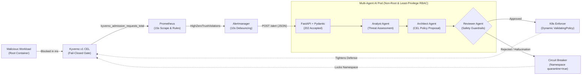

# Zero Trust Edge Workload Enforcement & Resilience

## Project Overview
This project simulates a disconnected, resource-constrained Edge/Combat Cloud node using lightweight Kubernetes (K3s). It enforces Zero Trust security at the workload level with Kyverno CEL policies to block privileged containers in milliseconds. When repeated attacks occur, an automated telemetry pipeline triggers an in-cluster asynchronous Multi-Agent AI service that validates threats, generates stricter policies, and isolates compromised namespaces—without human intervention or cloud connectivity.

## System Architecture

## Progress
- **Phase 1:** Built a simulated Edge Node using `k3d` (K3s in Docker) and deployed a root-level Nginx container (`insecure-nginx.yaml`) to establish an unprotected baseline.
- **Phase 2:** Deployed Kyverno as a fail-closed admission controller. Wrote a CEL-based `ValidatingPolicy` (`policies.kyverno.io/v1`) to block any pod without `runAsNonRoot: true`, configured namespace exclusions for core system tools, and verified compliant workloads (`nginx-unprivileged`).
- **Phase 3:** Installed a lightweight Prometheus server via Helm and added scrape annotations (`prometheus.io/scrape`) to the Kyverno service. Simulated repeated root-container injection attempts and tracked blocked requests using the `kyverno_admission_requests_total` metric.
- **Phase 4:** Upgraded workloads to a 2-replica `Deployment` and installed **Chaos Mesh** (configured for K3s `containerd`) to run scheduled `PodChaos` kill tests, proving 1-second auto-healing under continuous failure. Enabled Prometheus **Alertmanager** with 10-second alert grouping (debouncing) to merge attack spikes into single webhook payloads.
- **Phase 5:** Built and containerized an asynchronous **Multi-Agent AI** response service (`FastAPI`, `Pydantic`, Kubernetes Python client) running inside K3s as a non-root, read-only pod with **Least-Privilege RBAC** (`ServiceAccount` + `ClusterRole`). Added Prometheus alerting rules (`HighZeroTrustViolations`) to trigger the `Analyst -> Architect -> Reviewer` pipeline automatically. Approved rules deploy live Kyverno CEL policies (`ai-hardening-default`), while unsafe or hallucinated outputs trip a deterministic `quarantine=true` Circuit Breaker.